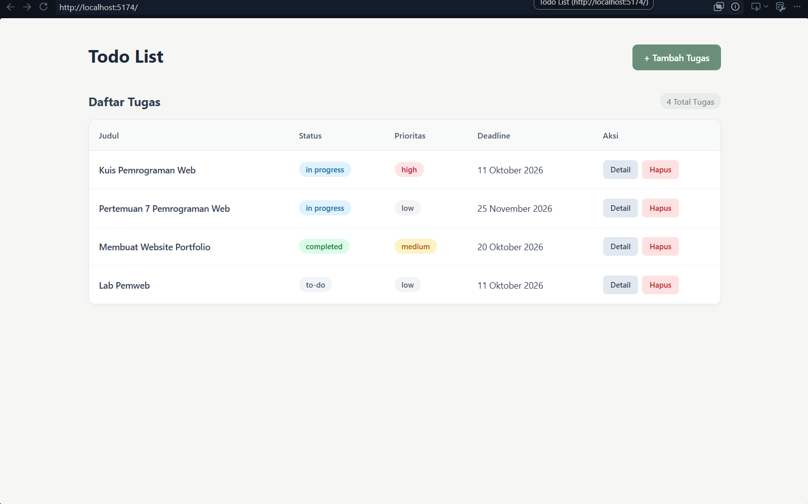
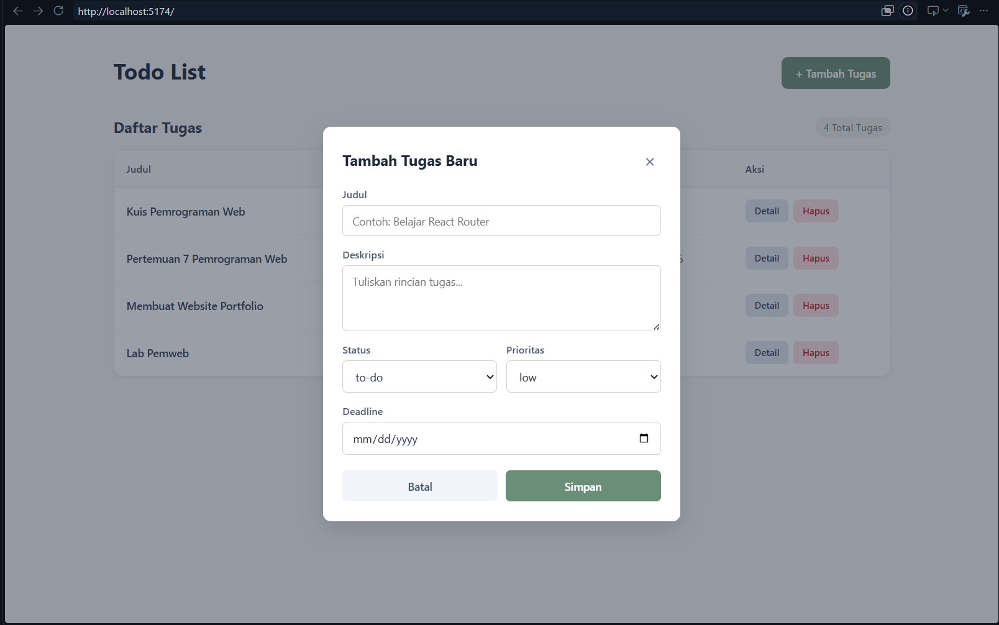
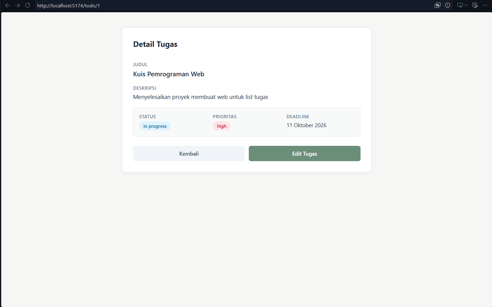
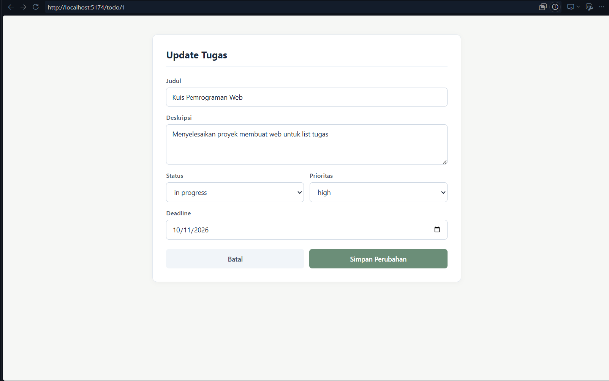
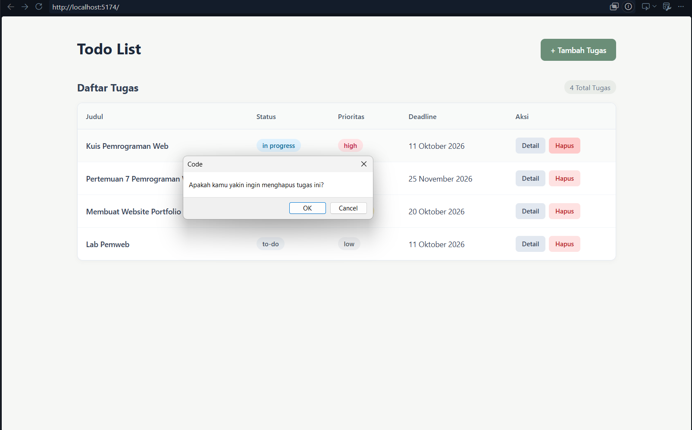

# Kuis-Pemweb-Lab1
Aplikasi To-Do List

Teknologi:
1. React.js
2. React Router DOM
3. Vite
4. CSS

Fitur website:
1. Menampilkan daftar eluruh tugas dalam bentuk tabel interaktif.
2. Menambahkan tugas baru.
3. Memperbarui status, prioritas, atau informasi tugas.
4. Menghapus tugas dengan fitur konfirmasi.

Cara menjalankan:
1. Clone repository
2. Masuk ke terminal 
3. jalankan npm run dev

### 1. Halaman Utama

### 2. Tambah Tugas

### 3. Detail Tugas

### 4. Update Tugas

### 5. Konfirmasi Hapus Tugas

